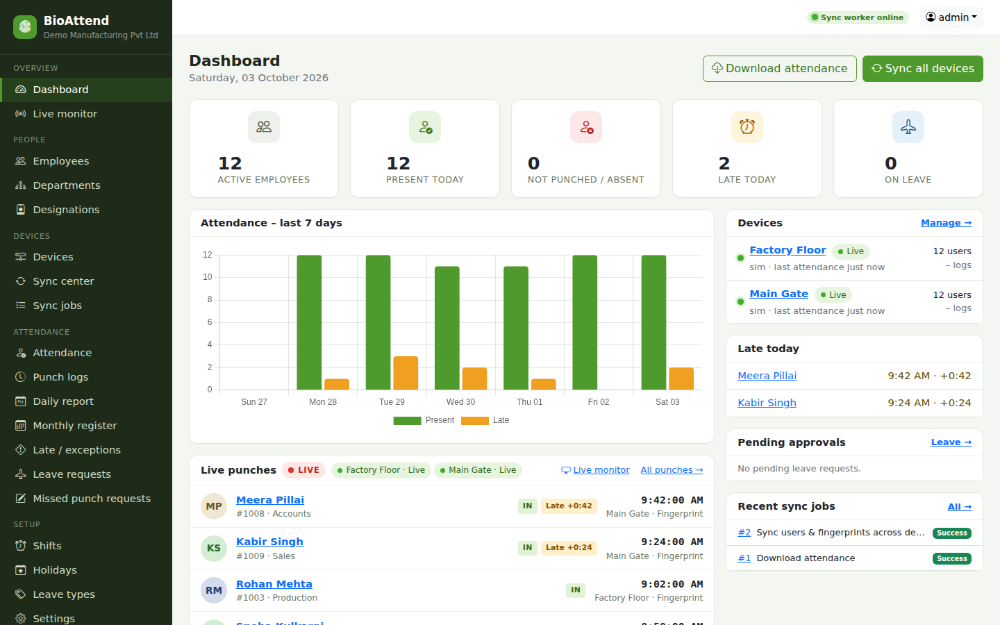
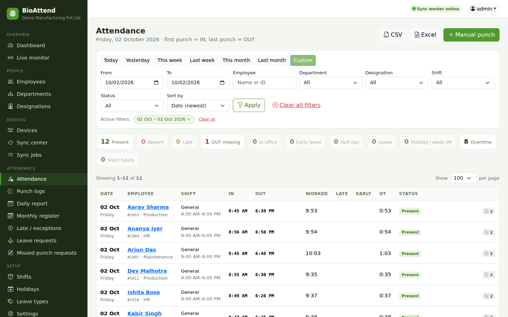
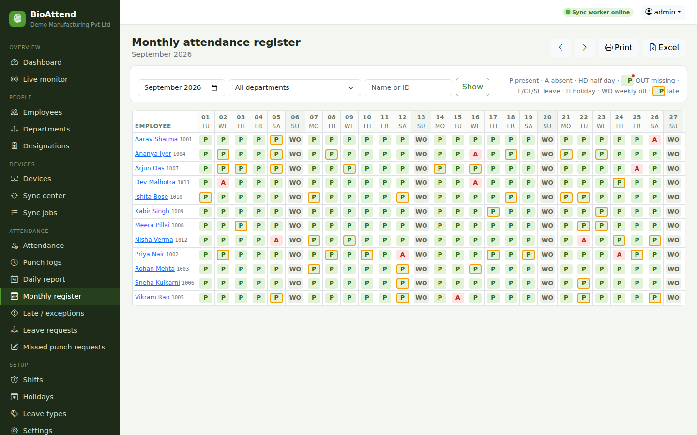
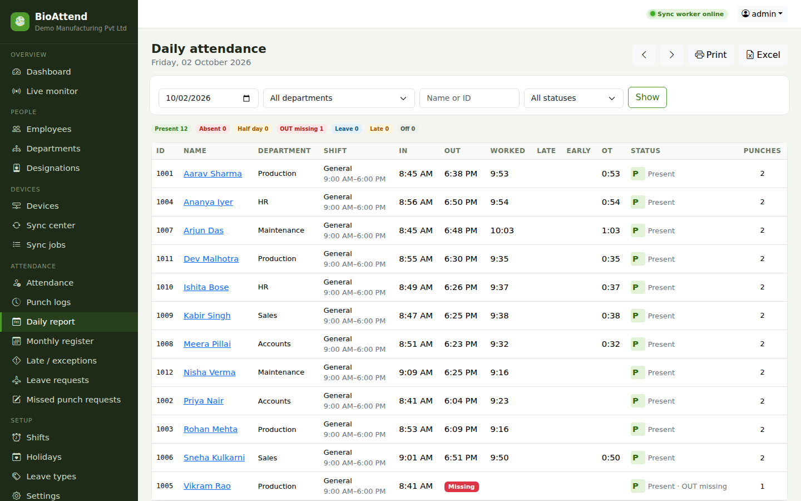
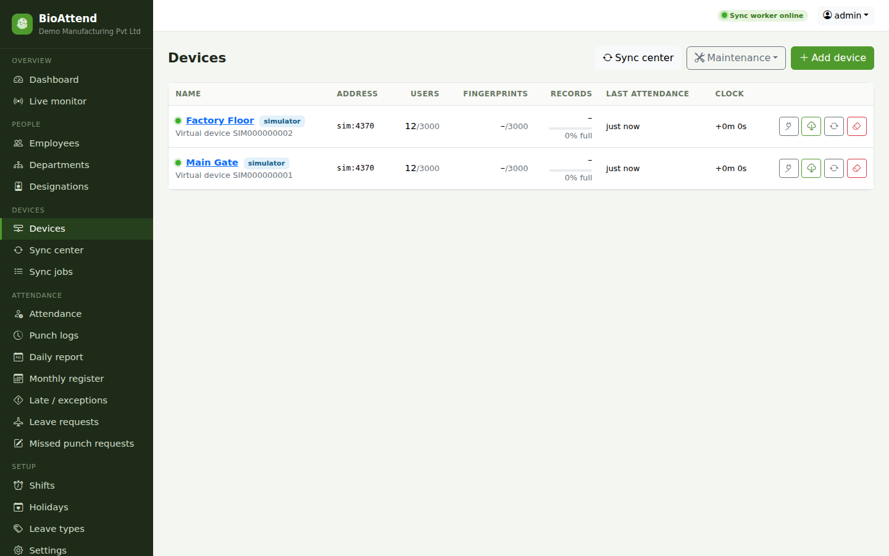

# BioAttend – Biometric Attendance System for ZKTeco Devices

**BioAttend** is attendance management software for **ZKTeco** fingerprint and RFID terminals. It keeps employees
and fingerprints in sync across all your devices, collects every punch (live), and turns them into daily and monthly
attendance reports with Excel export. Run it as a desktop app on **Windows, Linux or Mac**, or on a server with Docker.

**[Website](https://sousvkeet.github.io/Biometric-attendence-system/)** ·
**[Download](https://github.com/sousvkeet/Biometric-attendence-system/releases/latest)** ·
[Windows](docs/WINDOWS_APP.md) · [Linux](docs/LINUX_APP.md) · [Mac](docs/MAC_APP.md) · [Server](docs/DEPLOYMENT.md)



Works with ZKTeco standalone terminals that use the ZKTeco TCP/IP protocol (port 4370). Tested with the
**ZKTeco x 2008** (ZLM30_TFT, firmware Ver 6.70) and the **ZKTeco K45 Pro/ID**.

## Download

Desktop apps for Windows, Linux and Mac (complete system, no server needed):
**[Releases](https://github.com/sousvkeet/Biometric-attendence-system/releases/latest)**

| File | For |
|---|---|
| `BioAttend-Setup-<version>.exe` | Windows: one user, no administrator rights |
| `BioAttend-<version>.msi` | Windows: IT deployment for all users (Group Policy / Intune / SCCM) |
| `BioAttend-portable-<version>.zip` | Windows: no installation |
| `BioAttend-CodeSigning.cer` + `Trust-BioAttend-Certificate.ps1` | Windows: make office PCs trust the digital signature |
| `bioattend_<version>_amd64.deb` | Linux: Ubuntu, Debian, Mint |
| `bioattend-<version>-1.x86_64.rpm` | Linux: Fedora, RHEL, Rocky, Alma |
| `BioAttend-<version>-x86_64.AppImage` | Linux: any distribution, no installation |
| `BioAttend-<version>-linux-x86_64.tar.gz` | Linux: any distribution, no installation |
| `BioAttend-<version>-macos-arm64.dmg` | Mac with Apple Silicon (M1–M4) |
| `BioAttend-<version>-macos-x86_64.dmg` | Mac with an Intel processor |

## Installation

**Production:** see **[docs/DEPLOYMENT.md](docs/DEPLOYMENT.md)**. It covers Docker Compose (recommended), a Linux server with
systemd, or a Windows PC with WSL, plus HTTPS, PostgreSQL, backups, upgrades, monitoring, a go-live checklist and
troubleshooting. Run `manage.py production_check` before going live.

**Windows desktop app (no server):** see **[docs/WINDOWS_APP.md](docs/WINDOWS_APP.md)**. `BioAttend-Setup.exe` installs the
complete system on one Windows PC (window + system tray, built-in database, live punches, backups); no Python or server needed.

**Linux desktop app (no server):** see **[docs/LINUX_APP.md](docs/LINUX_APP.md)**. The same complete system as an AppImage,
.deb, .rpm or .tar.gz for Ubuntu 22.04+, Debian 12+, Fedora, RHEL 9+ and others. It runs in the background, starts at login, and opens as
an app window; no Python or server needed. Build it with `desktop/build_linux.sh` (Docker).

**Mac app (no server):** see **[docs/MAC_APP.md](docs/MAC_APP.md)**. The same complete system for macOS 12+ (Apple Silicon and
Intel): a native window with an Actions menu, running in the background and starting at login. It is built on GitHub's
Macs (`.github/workflows/mac-app.yml`) or on any Mac with `desktop/build_macos.sh`.

**Quick start / development:**

```bash
python3 -m venv .venv && .venv/bin/pip install -r requirements.txt
cp .env.example .env && chmod 600 .env      # set SECRET_KEY (required), ALLOWED_HOSTS, TIME_ZONE
.venv/bin/python manage.py migrate
.venv/bin/python manage.py setup_system     # defaults + prints the one-time setup code
./run.sh                                    # http://localhost:8090 – web + worker, stops with Ctrl+C
#   open the portal: the first-time setup page creates the administrator (username, email, password)
```

Two processes are needed: the web server and **exactly one** worker (`manage.py run_worker`), which talks to the devices.
The top bar shows "Sync worker online/offline"; `GET /healthz` reports it for monitoring tools.

## Features

| Area | What you get |
|---|---|
| Devices | Add/edit devices (IP, port, comm key, area), connection test, live device info (model, serial, firmware, FP version, users/fingerprints/records vs. capacity, clock drift), enroll vs. normal machine, write protection |
| Sync | Download users + fingerprints, upload employees + fingerprints, **sync all devices** (every employee and fingerprint on every device), download attendance (incremental, de-duplicated), sync device clocks, **preview upload (dry run)**, remote fingerprint enrollment (beta) |
| Automation | Attendance downloaded every 5 min and users synced every 30 min (configurable in Settings); new or edited employees are sent to the devices immediately |
| Employees | Register/edit, departments, designations, shifts, card number, device password, device privilege, device restriction, fingerprint status per device, self-service login, Excel export, cleanup of former staff |
| Attendance | Punch log (filters, CSV/Excel), manual punches (audited), daily report, monthly register (P/A/HD/MP/L/H/WO), late/early/missed/absent/overtime report, per-employee attendance card, night shifts |
| Leave | Leave types with yearly quota, requests and approvals, balances |
| Self-service | Employees see their own attendance, apply for leave, report missed punches |
| Audit | Activity log of admin actions, job log of every device conversation |

## Screenshots

| Attendance | Monthly register |
|---|---|
|  |  |
| **Daily report** | **Devices** |
|  |  |

The screenshots use made-up demo data. To try BioAttend with the same data, run `manage.py demo_data` on an empty
database (it refuses to run when employees or devices exist; the demo devices are simulators).

## How multi-device sync works

* A person is identified by the **user ID (PIN)**, which is the same on every device. The internal record slot
  (`uid`) may differ per device and is chosen automatically, never reusing a slot that belongs to someone else.
* **Sync all devices** (button, or automatic):
  1. Reads every device. New users/fingerprints enrolled on an **enroll machine** are imported into the portal.
  2. Uploads to every device each active employee and fingerprint it doesn't have yet.
* Typical workflow for a new employee: *Employees → Register employee* (sent to all devices) → enroll the
  fingerprint on any device → the next sync (or *Sync all devices*) copies it to all other devices.

## Device safety rules (enforced in code)

* **Attendance records are never deleted from a device automatically.** The pyzk clear/poweroff/restart and
  delete commands are replaced at start-up with a function that raises an error. Erasing all data and power-off
  are never possible.
* **Maintenance** (manual), on a device page or for several devices at once (**Devices → Maintenance**, which
  works through the ticked devices one after the other):
  * **Reboot device** (staff): restarts the device, waits until it answers again, and deletes nothing.
  * **Clear attendance records** (main administrator only, and the device name must be typed to confirm):
    frees the device's attendance memory. First the keypad is locked and every record is downloaded and looked
    up in the portal database. A CSV safety copy is written to `var/device-records/`. If any check fails,
    nothing is deleted. You choose the records to keep (last 6 months to 3 years, or a date range). ZKTeco
    devices can only be cleared completely, so that period is checked and kept in the portal. Users, fingerprints and cards stay on the device. Write-protected devices are never
    cleared.
* The only device deletion is **removing an employee you delete** with “Delete from: portal and all devices”:
  only that person's user record and fingerprints are deleted, and only when both the ID *and* the name match
  (a different person re-using the ID is left alone). Write-protected devices are skipped; offline devices are
  retried automatically. A backup (details + fingerprints) is kept, so **Employees → Removed → Restore** puts
  the person back on every device. Choose “Portal only” to leave the devices unchanged.
* Existing device users are only rewritten when name, card or password actually differ. Empty portal values
  never overwrite device values.
* Privileges of users already on a device are never changed. A user ID that exists on a device under a clearly
  different name is reported as a **conflict** and left untouched.
* Fingerprints are only *added*; the user's existing fingerprints are always re-sent with them so none are lost.
  Device fingerprint memory (800 on the x 2008) is checked first.
* Deactivating an employee does **not** remove them from the devices (deleting can, see above).
* **Write protection (read-only)** per device: the portal then only reads. Use *Preview upload (dry run)* to see
  exactly what an upload would change before turning write protection off.

## Known limitations

* Face templates are not synced (the pyzk library cannot transfer them); fingerprints, cards and passwords are synced.
* Device privileges other than *normal user* and *super admin* (e.g. enroller/manager) are kept on their original
  device but created as normal users on other devices.
* Remote enrollment depends on firmware support. If it fails, enroll on the device menu and run a sync.
* All devices must use the same fingerprint algorithm version (shown on each device page) for copied fingerprints to work.

## Tests

```bash
.venv/bin/python manage.py test
```

The sync tests use **simulator devices** (virtual devices stored as JSON) so writes can be tested without hardware.
You can also add simulator devices in the UI (Driver = Simulator) to try the system safely.

## Database backups

**Setup → Backups** (main administrator only):

* Destinations: local folder / mounted network drive, **Amazon S3 or S3-compatible** (Wasabi, MinIO, Backblaze B2,
  DigitalOcean Spaces, Cloudflare R2), **FTP**, **FTPS**, **SFTP** (password or private key; the server key is
  remembered on first connection and checked afterwards), **WebDAV** (Nextcloud, ownCloud, Synology) and **rclone**
  (Google Drive, OneDrive, Dropbox, Box, Mega, pCloud, Azure Blob, Google Cloud Storage and 70+ more). Use several
  at once – e.g. a local copy plus an off-site one. Each has *Test*, a list of stored backups with *Download*, and
  *Keep last N* (retention only ever removes `bioattend-backup-…` files created by this system).
* Schedule: daily at a set time, every 6 or 12 hours, or weekly – plus *Back up now*.
* Backups are consistent online snapshots (SQLite backup API / `pg_dump`), compressed, integrity-checked and – by
  default – **encrypted with your passphrase** (they contain personal data and fingerprint templates).
  **Keep the passphrase safe; encrypted backups cannot be restored without it.** Destination passwords/keys are stored
  encrypted with `SECRET_KEY` (changing `SECRET_KEY` means re-entering them).
* **Login details:** by default, backups leave out user accounts, password hashes and sessions. Change this with
  "Include user accounts & passwords". Restoring keeps the current accounts and passwords by default, so nobody is
  signed out. Untick that option to bring back the accounts stored in a complete backup.
* **Back up without signing in:**
  * command line: `manage.py backup_now [--with-logins | --without-logins]`
  * Windows app: tray → *Back up now*, or the Start-menu shortcut *Back up BioAttend now*
  * Linux app: right-click the launcher → *Back up now*, or `bioattend --backup`
  * Mac app: *Actions → Back up now*
* rclone: create the remote with `rclone config` on any computer with a browser, then paste the output of
  `rclone config show NAME` into the destination (stored encrypted; refreshed tokens are saved automatically).
  The portal uses `var/bin/rclone` (downloaded v1.75.1, checksum-verified) or `rclone` on the PATH; set
  `RCLONE_BINARY` in `.env` to use another. On a new server: `curl https://rclone.org/install.sh | sudo bash`.

**Restore from the website** (Backups → a destination's 📂 → **Restore**, or **Upload & restore** a file, or **Undo**
with a safety copy): confirm with your admin password and `RESTORE`. By default the current data is backed up first.
The portal shows a progress screen to everyone and pauses device syncs, live punches and backups; the file is
downloaded, decrypted and integrity-checked *before* anything is replaced (any failure up to then changes nothing),
a safety copy of the current database is kept (last 5, in `var/backups/pre-restore/`), the database is upgraded
to the current version, and a full attendance download recovers punches made after the backup. Everyone is signed
out; sign in with the password that was valid when the backup was made.

Restore from the command line (stop the portal first):

```bash
.venv/bin/python manage.py restore_backup --destination "Offsite S3" --list
.venv/bin/python manage.py restore_backup --destination "Offsite S3" --latest      # keeps current logins
.venv/bin/python manage.py restore_backup --destination "Offsite S3" --latest --restore-logins
.venv/bin/python manage.py restore_backup /path/to/bioattend-backup-20261002-020000.sqlite3.gz.enc
```

## Security

* Roles: employees see only their own pages; HR staff manage people/devices/attendance; only the main
  administrator (superuser) can use Backups/Restore or change administrator logins.
* Logins are locked for 15 minutes after 5 failed attempts (per username + IP; logged in the activity log).
  Passwords: at least 8 characters, not common, not only digits, not similar to the username.
* CSRF on every form, logout is POST-only, CSP / X-Frame-Options / nosniff headers, open redirects blocked,
  spreadsheet formula injection neutralised in Excel/CSV exports.
* Keep `DEBUG=false` and a long random `SECRET_KEY` in `.env` (the portal refuses to start without one).
  `.env`, the database and `var/` are private to the portal's user (files are created with umask 077).
* Serving over HTTPS (recommended when used beyond this PC): put a reverse proxy with a certificate in front
  (e.g. Caddy/nginx) and set `HTTPS=true` for secure cookies and HSTS.
